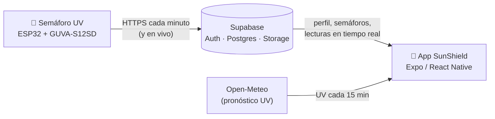
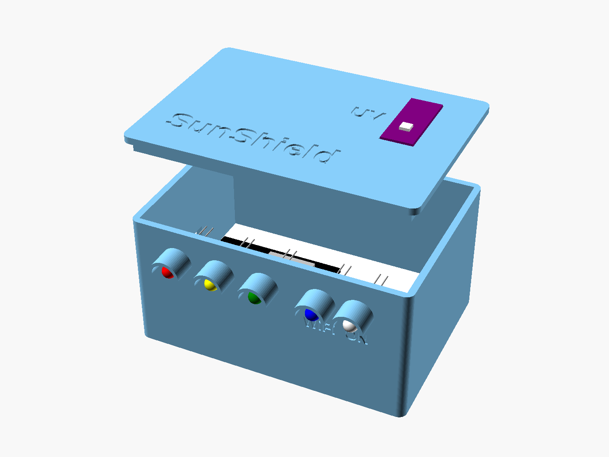
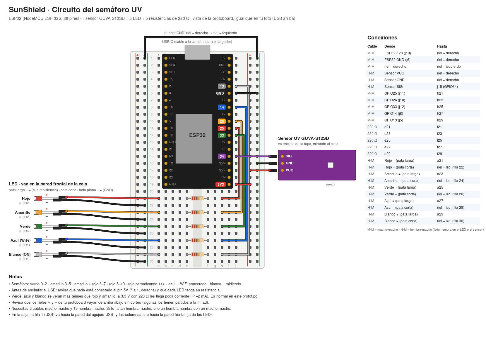

# ☀️ SunShield · Semáforo UV

**Una app móvil y un semáforo UV físico para proteger del sol a quienes más se exponen en Urcuquí (Imbabura, Ecuador).**

Urcuquí está a menos de 50 km de la línea equinoccial y a unos 2400 m de altura: el índice UV suele estar entre **8 y 9 (muy alto)** casi todo el año, incluso en días frescos o nublados. Aun así, mucha gente trabaja o estudia al aire libre sin saber cuándo ni cómo protegerse.

---

## 💡 La idea

SunShield trabaja en dos capas que se complementan:

| Capa | Qué es | Para qué sirve |
|------|--------|----------------|
| 📱 **Personal** — la app | App móvil gratuita (Android) | UV actual y pronóstico de tu ubicación, horario de protección, tiempo hasta quemarte según tu tipo de piel y recomendaciones según tu perfil. Funciona sin internet. |
| 🚦 **Comunitaria** — el semáforo | Dispositivo fijo con ESP32 y sensor UV | Mide el UV **real** en un lugar (un colegio, un mercado, un campo) y lo muestra con luces: cualquiera lo entiende **sin celular**. Envía sus lecturas a la nube para consultarlas en la app. |

**Público objetivo:** trabajadores del campo, estudiantes, docentes y personal universitario, y comerciantes de mercado o de calle.

**Modelo propuesto:** la app es gratuita para las personas; colegios, universidades, empresas agrícolas y municipios adquieren semáforos y acceden a los datos de sus dispositivos.

---

## 🧭 Cómo funciona



- El **semáforo** mide el UV cada segundo y enciende sus luces aunque no haya internet. Cada minuto envía a Supabase el promedio y el máximo; si cambia el UV, también envía el valor **en vivo**. Sin WiFi guarda hasta 24 h de lecturas y las envía al reconectarse.
- La **app** pide el pronóstico a [Open-Meteo](https://open-meteo.com) (gratuito, sin clave), lee de Supabase el perfil del usuario y las lecturas de los semáforos, y guarda los datos en el teléfono para funcionar sin conexión hasta 7 días.

---

## 📱 La app

| Pantalla | Qué muestra |
|----------|-------------|
| **Acceso** | Registro con correo o **«Entrar sin cuenta»** (invitado). La cuenta de invitado se puede guardar después con un correo sin perder el perfil. |
| **Perfil** | Edad, ocupación, tiempo y horario al sol, protección habitual y **tipo de piel (Fitzpatrick I–VI)**. Avatar o foto privada. |
| **Hoy** | UV actual con la escala de la OMS, UV máximo del día, **horario de protección**, tiempo hasta quemarte, aviso de nubes, clima y **recomendaciones personalizadas**. |
| **Dashboard** | UV del día en barras cada 15 min con la línea «Ahora», y UV máximo de los últimos / próximos 7 días. Opción de ver el UV sin nubes. |
| **Semáforos** | Lista (del más cercano al más lejano) y **mapa** de los semáforos con su UV medido **en vivo**. El detalle muestra el «semáforo del día», el tiempo en cada nivel y el historial de 7 días. |
| **Aprende** | Qué es el índice UV, la escala de la OMS y datos sobre el sol en Urcuquí. |

- **Idiomas:** español, inglés y kichwa *(la traducción al kichwa es un borrador y debe revisarla un hablante nativo)*.
- **Sin internet:** muestra los últimos datos guardados y recalcula el UV actual con la hora del teléfono.
- Las recomendaciones son orientativas y no reemplazan la consulta médica.

---

## 🚦 El semáforo UV

<p align="center">
  
  
</p>

**Componentes:** ESP32 DevKit de 38 pines (NodeMCU ESP-32S), sensor UV GUVA-S12SD, 5 LED (rojo, amarillo, verde, azul, blanco), 5 resistencias de 220 Ω, protoboard de 400 puntos, cables Dupont y un power bank USB.

**Luces:**

| Luz | Significado |
|-----|-------------|
| 🟢 Verde | UV 0–2 · bajo |
| 🟡 Amarillo | UV 3–5 · moderado |
| 🟡🔴 Amarillo + rojo | UV 6–7 · alto |
| 🔴 Rojo | UV 8–10 · muy alto |
| 🔴 Rojo parpadeando | UV 11+ · extremo |
| 🔵 Azul | Fijo = WiFi conectado · parpadea = sin WiFi |
| ⚪ Blanco | Destello al medir y al enviar |

**Firmware** ([hardware/firmware/semaforo_uv/](hardware/firmware/semaforo_uv/)): convierte los milivoltios del sensor a índice UV, obtiene la hora por NTP, envía por HTTPS con verificación de certificado y tiene un **modo prueba** desde el Monitor serie para simular cualquier UV (las lecturas simuladas no se envían).

**Caja** ([hardware/caja/](hardware/caja/)): diseño paramétrico en OpenSCAD de 100 × 70 × 50 mm, con los LED al frente con viseras y el sensor encima de la tapa (el plástico bloquea el UV). Los archivos `*_IMPRIMIR.stl` son los que se imprimen.

---

## 🗂️ Estructura del repositorio

```
semaforo-uv/
├── src/
│   ├── app/          # Pantallas (Expo Router: cada archivo es una ruta)
│   ├── components/   # Gráficas, medidor UV, mapa, formularios…
│   ├── context/      # Sesión, perfil, idioma y datos UV compartidos
│   ├── services/     # Open-Meteo, Supabase, semáforos, recomendaciones
│   ├── hooks/        # Valores en vivo (Supabase Realtime)
│   └── i18n/         # Textos en español, inglés y kichwa
├── supabase/         # Scripts SQL: tablas, seguridad (RLS) y datos de demostración
├── hardware/
│   ├── firmware/     # Programa del ESP32 (Arduino)
│   ├── circuito/     # Diagrama de conexiones
│   └── caja/         # Caja 3D (OpenSCAD + STL)
└── scripts/          # check-uv.mjs: pruebas de la lógica de UV
```

---

## 🚀 Puesta en marcha

### 1. Supabase

1. Crea un proyecto en [supabase.com](https://supabase.com).
2. En **SQL Editor**, ejecuta en este orden:
   - [supabase/profiles.sql](supabase/profiles.sql) — perfiles y fotos.
   - [supabase/semaforos.sql](supabase/semaforos.sql) — semáforos, lecturas y valor en vivo.
   - [supabase/semaforo_demo.sql](supabase/semaforo_demo.sql) — *(opcional)* un semáforo con datos simulados para probar la app sin esperar al sol: `select public.seed_demo_readings();`
3. En **Authentication → Sign In / Providers**, activa *Allow anonymous sign-ins* y *Allow manual linking* (para el modo invitado).

### 2. App

Crea un archivo `.env.local` en la raíz con los datos de tu proyecto (**Project Settings → API**):

```bash
EXPO_PUBLIC_SUPABASE_URL=https://TU_PROYECTO.supabase.co
EXPO_PUBLIC_SUPABASE_KEY=sb_publishable_...
```

Instala y arranca:

```bash
npm install
npx expo start
```

Escanea el código QR con **Expo Go** en tu Android.

Comprobaciones:

```bash
npm run check:uv     # escala OMS, horario de protección, cálculo sin internet y recomendaciones
npx tsc --noEmit     # tipos
npx expo lint        # estilo
```

### 3. Semáforo

1. Arma el circuito según [hardware/circuito/circuito_semaforo.png](hardware/circuito/circuito_semaforo.png).
2. Registra el semáforo en el SQL Editor y **guarda la clave** que devuelve (solo se muestra una vez):
   ```sql
   select public.register_device('Nombre', 'Lugar', latitud, longitud);
   ```
3. Copia `secretos.ejemplo.h` como `secretos.h` (no se sube a GitHub) y completa el WiFi (2,4 GHz), los datos de Supabase y la clave del semáforo.
4. Abre `semaforo_uv.ino` en Arduino IDE 2 con el core **esp32 de Espressif**, elige la placa *ESP32 Dev Module* y súbelo.

### 4. APK de demostración (opcional)

Registra `EXPO_PUBLIC_SUPABASE_URL` y `EXPO_PUBLIC_SUPABASE_KEY` en el entorno `preview` de EAS y ejecuta:

```bash
npx eas-cli@latest build -p android --profile preview
```

---

## 🛠️ Tecnologías

- **App:** Expo SDK 57, React Native, TypeScript, Expo Router, react-native-svg, Leaflet + OpenStreetMap (mapa).
- **Backend:** Supabase (Auth, PostgreSQL con RLS, Storage privado, Realtime).
- **Datos:** Open-Meteo Forecast API.
- **Hardware:** ESP32 + GUVA-S12SD, Arduino IDE 2, OpenSCAD.

---

## ⚠️ Limitaciones conocidas

- Los valores de Open-Meteo son **estimaciones de un modelo**, no mediciones.
- El sensor del semáforo **todavía no está calibrado**; tras calibrarlo se espera una precisión de ±1 punto de UV.
- La caja de PLA es solo para demostración: para exterior hace falta PETG o ASA, sellado contra la lluvia y una ventana que deje pasar el UV.
- La configuración de Supabase es de desarrollo (sin confirmación de correo ni captcha para invitados).

## 🔜 Próximos pasos

- Calibrar el sensor con un día despejado.
- Notificaciones push cuando un semáforo pasa a **rojo** o **extremo**.
- Imprimir la caja e instalar el semáforo.
- Antes de publicar: confirmación de correo, aviso de privacidad y captcha.

---

## 📄 Licencia

MIT — ver [LICENSE](LICENSE).
